<div align="center">



[](https://git.io/typing-svg)

</div>

---

## 📜 The Explorer's Codex

```
  Cartographer   →  Rohit Yadav
  Port of origin →  Mumbai, Maharashtra, Bharata 🇮🇳
  Craft          →  Data Science · AI Engineering · Finance × ML
  Summits        →  Tungnath · Kedarkantha · Sahyadri · (K2, someday) 🏔️
  Fuel           →  chai · 90s Bollywood · ghazals · late nights ☕🎧
  Reads          →  Hindi literature
  Current climb  →  Deep Learning — PyTorch · TensorFlow · Transformers
```

---

## 🗺️ Click a Territory to Explore It

> The red markers on the map are lands I have crossed. The green ones I am exploring. The gold flag is where I stand today.

<details>
<summary><b>🔴 The Plains of Python & Data</b> — <i>where every explorer begins</i></summary>

<br>

Where the ropes and crampons were learned: **pandas, NumPy, Matplotlib, Seaborn**. First camp was a Linear Regression on Kaggle ecommerce data. Every later expedition leans on this ground.

</details>

<details>
<summary><b>🔴 The Kingdom of Classical ML</b> — <i>fraud · credit · churn</i></summary>

<br>

| Expedition | What it does |
|---|---|
| [Credit Card Fraud Detection](https://github.com/Rohit2255/Credit_Card_Fraud_Detection) | Imbalanced-data classification, Logistic Regression + SMOTE, 99.92% accuracy |
| [Customer Churn Prediction](https://github.com/Rohit2255/Customer_Churn_Prediction) | Logistic Regression and Random Forest, SMOTE, feature importance |
| [Credit Risk Scoring System](https://github.com/Rohit2255/credit_risk_scoring_system) | German Credit dataset, creditworthiness classification |
| [Stock Price Trend Classifier](https://github.com/Rohit2255/stock_price_trend_classifier) | SMA, EMA, RSI, MACD features, up/down prediction |
| [Loan Approval Predictor](https://github.com/Rohit2255/Loan_approval_predictor) | Approve/reject modelling |
| [Customer Segmentation](https://github.com/Rohit2255/Customer_segmentation_using_k-means_clustering-) | K-Means clustering |

</details>

<details>
<summary><b>🔴 The NLP Archipelago</b> — <i>spaCy · Word2Vec · LDA</i></summary>

<br>

**[Amazon Review Analysis](https://github.com/Rohit2255/Amazon-Review-Analysis)** — a full pipeline on 50,000 real reviews:

| Stage | Result |
|---|---|
| Text cleaning | 49.1% vocabulary noise removed |
| TF-IDF + Logistic Regression | 89% accuracy · positive F1 0.93 · negative F1 0.71 |
| LDA topic modelling | 8 named themes, lowest-rated topic: Packaging and Delivery (3.31★) |
| Word2Vec | `dog + food − treat` → purina, orijen, iams, canidae |
| spaCy NER | Brands extracted from raw review text |

Also in the archipelago: [Stock Market Sentiment Analyzer](https://github.com/Rohit2255/Stock-Market-Sentiment-Analyze) (financial headlines) and [Bitcoin Sentiment from Twitter](https://github.com/Rohit2255/Bitcoin-Sentiment-Analysis-Twitter-).

</details>

<details>
<summary><b>🟢 The Finance Frontier</b> — <i>ESG · NPA · BNPL</i></summary>

<br>

| Expedition | What it does |
|---|---|
| [BNPL Risk Model](https://github.com/Rohit2255/Buy-Now-Pay-Later-BNPL-Risk-Model) | Predicts borrower default for a Buy-Now-Pay-Later setting |
| [NPA Risk Analysis](https://github.com/Rohit2255/NPA-Risk-Analysis-for-Bank-Loan-Portfolio) | Non-performing asset risk across a bank loan portfolio |
| [ESG Score Predictor](https://github.com/Rohit2255/ESG-Score-Predictor-for-Companies) | Company sustainability scoring |
| [Credit Risk Default Predictor](https://github.com/Rohit2255/Credit-Risk-Default-Predictor) | Default modelling |
| [SIP ROI Simulator](https://github.com/Rohit2255/SIP-ROI-Simulator) | Personal-finance return simulation |
| [Global Inflation Trend Visualizer](https://github.com/Rohit2255/-Global-Inflation-Trend-Visualizer) | Economic trends, visualised |

</details>

<details>
<summary><b>🟢 The Deployment Pass</b> — <i>Flask · Streamlit</i></summary>

<br>

Models are only maps until someone can use them. Shipped with Streamlit: [Insurance Claim Approval Prediction](https://github.com/Rohit2255/Insurance-Claim-Approval-Prediction) and [Automated Credit Risk Predictor](https://github.com/Rohit2255/Automated_credit_risk_predictor) (PCA + K-Means segmentation).

</details>

<details>
<summary><b>🟡 The Deep Learning Mountains</b> — <i>ascending now</i></summary>

<br>

```
  PyTorch fundamentals          [ in progress 🔄 ]
  TensorFlow neural networks    [ in progress 🔄 ]
  Transformers (HuggingFace)    [ ahead       ⏳ ]
```

</details>

<details>
<summary><b>⬛ Hic Svnt Dracones</b> — <i>the unknown lands</i></summary>

<br>

```
  LLM systems · RAG · Agents · MLOps
  The old maps just say: here be dragons.
  I intend to cross them and redraw the map.
```

</details>

---

## 🐉 The Bestiary — Dragons I Have Slain

Every explorer is measured by the monsters met. These are mine, each from a real battle.

| Dragon | Where I met it | How it was slain |
|---|---|---|
| 🐍 **The NaN Serpent** | `float has no attribute 'lower'` while cleaning 50k reviews | `isinstance(text, str)` guards and `fillna('')` after every CSV load |
| 🐙 **The Imbalance Hydra** | 64% of reviews were 5-star, so the negative class starved | Stratified splits, per-class F1, and `class_weight` as the next weapon |
| 🪞 **The Accuracy Mirage** | 89% accuracy hiding a negative F1 of 0.71 | Never trust accuracy alone; read precision, recall and F1 per class |
| 👻 **The Domain-Drift Wraith** | spaCy tagged "LOVED" and "Vanilla" as organisations | Post-filtering the entities; a news-trained model needs a food-review reality check |
| 🌀 **The Kernel Labyrinth** | spaCy "installed" yet `ModuleNotFoundError` | `sys.executable -m pip` installs straight into the exact Python Jupyter runs |

---

## 🧭 The Navigator's Instruments

```
  Language of maps   →  Python
  Measuring tools    →  Pandas · NumPy · Matplotlib · Seaborn
  Terrain analysis   →  scikit-learn · XGBoost · SMOTE
  Reading the wind   →  NLTK · spaCy · Gensim
  Camp construction  →  Flask · Streamlit · Docker
  Water finding      →  SQL · MySQL
  Deep cartography   →  PyTorch · TensorFlow   (learning)
  Celestial charts   →  Git · Linux · Bash
```

---

## 📡 Expedition Records

<div align="center">


[](https://git.io/streak-stats)

</div>

---

## 📖 From the Explorer's Journal

<div align="center">

```
  ┌────────────────────────────────────────────────────────────┐
  │                                                            │
  │   On Tungnath, above the treeline, I learned the rule:     │
  │   the mountain rewards the one who keeps walking.          │
  │                                                            │
  │   Kedarkantha taught me patience.                          │
  │   The Sahyadri taught me beauty in fog.                    │
  │   Data taught me to distrust a number that looks too good. │
  │                                                            │
  │   The map is not finished. That is the point.              │
  │                                                            │
  │                          — Rohit, somewhere uphill         │
  └────────────────────────────────────────────────────────────┘
```

</div>

---

## 🕊️ Send a Carrier Pigeon

<div align="center">

[](https://twitter.com/ashwathama56)
[](https://www.linkedin.com/in/rohit-kumar-yadav-b97360194/)
[](https://www.kaggle.com/rohit2255)
[](https://www.hackerrank.com/profile/ry661432)
[](mailto:ry661432@gmail.com)

<br>

*"The map is not the territory — but it shows you where the dragons are."*


**~ Carta Machinae Intelligentis · Mumbai · MMXXVI ~**

</div>
