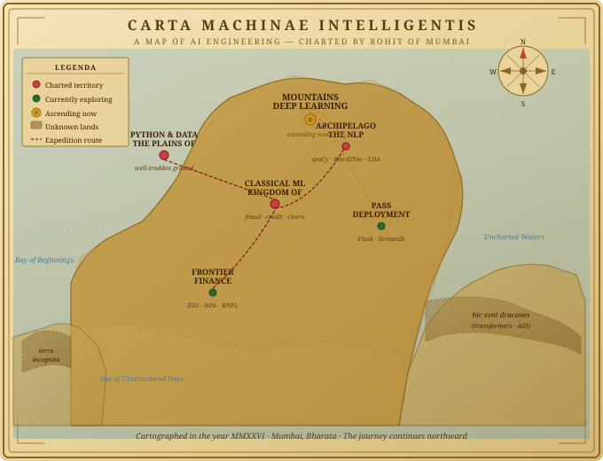

<div align="center">



</div>

---

<div align="center">

[](https://git.io/typing-svg)

</div>

---

<div align="center">

*"Not all those who wander are lost —*
*some are training models at 3am in Mumbai."*

</div>

---

## 📜 The Explorer's Codex

```
  Name of Cartographer  →  Rohit Yadav
  Port of Origin        →  Mumbai, Maharashtra, Bharata 🇮🇳
  Current Expedition    →  AI Engineering · Deep Learning · NLP
  Tools of Navigation   →  Python · PyTorch · sklearn · spaCy · HuggingFace
  Fuel for the Journey  →  chai · 90s Bollywood · night shifts ☕🎧
  Known Summits         →  Tungnath · Kedarkantha · Sahyadri 🏔️
  The Grand Dream       →  Remote work from a village above the clouds 🌍
  Year of This Scroll   →  MMXXVI
```

---

## 🗺️ Territories Charted — The Expedition Log

> *The red markers show where I have walked.*
> *The gold marker shows where I climb now.*
> *The dark shaded lands beyond — those are next.*

---

### 🔴 The Plains of Python & Data
*Well-trodden ground. Where all explorers begin.*
```
  Mastered the ropes of pandas, numpy, matplotlib
  First models built here — Linear Regression, EDA
  The foundation upon which all other lands rest
```

---

### 🔴 The Kingdom of Classical ML
*Vast, fertile, full of practical power.*
```
  Credit Card Fraud Detector      → 99.92% accuracy · SMOTE · LogReg
  Loan Approval Predictor         → binary classification pipeline
  Customer Churn Prediction       → Random Forest · SMOTE · deployment-ready
  Credit Risk Scoring System      → German Credit dataset · feature importance
  Automated Credit Risk           → PCA + KMeans + Streamlit
  Stock Price Trend Classifier    → SMA · EMA · RSI · MACD
  Insurance Claim Predictor       → Streamlit deployed
  Customer Segmentation           → K-Means clustering
  BNPL Risk Model                 → credit default prediction · Fintech
  NPA Risk Analysis               → non-performing assets · Banking ML
  ESG Score Predictor             → company sustainability scoring
  SIP ROI Simulator               → personal finance ML
```

---

### 🔴 The NLP Archipelago
*A chain of islands, each one a different tongue.*
```
  Amazon Review NLP Pipeline
  ├─ 50,000 reviews processed end-to-end
  ├─ Text cleaning → 49.1% vocabulary noise removed
  ├─ TF-IDF sentiment classifier → 89% accuracy
  ├─ LDA topic modeling → 8 business themes, zero labels
  ├─ Word2Vec → dog + food − treat = purina 🤯
  └─ spaCy NER → 16 brands extracted from raw text

  Stock Market Sentiment Analyser → financial news headlines
  Bitcoin Sentiment via Twitter   → crypto + NLP signals
  Twitter Hate Speech Detector    → text classification
```

---

### 🔴 The Finance Frontier
*Where data meets money. My specialisation.*
```
  21+ projects across fraud · credit · risk · markets · personal finance
  Unique niche: the intersection of Finance × Data Science × ML
  "Numbers tell stories. I translate them for the market."
```

---

### 🟡 Deep Learning Mountains *(ascending now)*
*The hardest terrain. The most rewarding views.*
```
  PyTorch fundamentals            → [ IN PROGRESS 🔄 ]
  TensorFlow neural networks      → [ IN PROGRESS 🔄 ]
  CNN image classification        → [ LOADING      ⏳ ]
  HuggingFace Transformers        → [ AHEAD        📋 ]
```

---

### ⬛ Terra Incognita *(hic svnt dracones)*
*Here be dragons. The uncharted edge of the map.*
```
  LLM fine-tuning & RLHF         → [ UNCHARTED 🐉 ]
  RAG pipelines & Vector DBs      → [ UNCHARTED 🐉 ]
  AI Agents & Tool use            → [ UNCHARTED 🐉 ]
  MLOps · CI/CD for ML            → [ UNCHARTED 🐉 ]
  Production AI systems           → [ UNCHARTED 🐉 ]
```

---

## 🧭 The Navigator's Kit

```
  Essential instruments carried on every expedition:

  Language of Maps    →  Python
  Measuring Tools     →  Pandas · NumPy · Matplotlib · Seaborn
  Terrain Analysis    →  scikit-learn · XGBoost · SMOTE
  Reading the Wind    →  NLTK · spaCy · Gensim · HuggingFace
  Camp Construction   →  Flask · Streamlit · Docker
  Water Navigation    →  SQL · MySQL
  Deep Cartography    →  PyTorch · TensorFlow  ← learning
  Celestial Reference →  Git · Linux · Bash
```

---

## 📡 Expedition Records

<div align="center">


</div>

<div align="center">

[](https://git.io/streak-stats)

</div>

---

## 📖 From the Explorer's Journal

<div align="center">

```
  ┌──────────────────────────────────────────────────────────────┐
  │                                                              │
  │  Anno MMXXVI. I am mid-journey.                             │
  │                                                              │
  │  The Plains of Python I know well.                          │
  │  The Kingdom of ML I have crossed many times.               │
  │  The NLP Archipelago — charted, and still fascinating.      │
  │                                                              │
  │  But the Deep Learning Mountains loom ahead,                │
  │  and beyond them, the dark territories —                    │
  │  LLMs, Agents, Production Systems —                         │
  │  where the old maps simply read:                            │
  │                                                              │
  │           HIC SVNT DRACONES                                 │
  │           (here be dragons)                                 │
  │                                                              │
  │  I am not afraid of dragons.                                │
  │  I debug at 3am. I trek alone in the Himalayas.             │
  │  The map will grow.                                         │
  │                                                              │
  │                          — Rohit, Mumbai, MMXXVI            │
  └──────────────────────────────────────────────────────────────┘
```

</div>

---

## 🌄 Send a Carrier Pigeon

<div align="center">

[](https://twitter.com/ashwathama56)
[](https://www.linkedin.com/in/rohit-kumar-yadav-b97360194/)
[](https://www.kaggle.com/rohit2255)
[](https://www.hackerrank.com/profile/ry661432)
[](mailto:ry661432@gmail.com)

</div>

---

<div align="center">

*"The map is not the territory —*
*but it shows you where the dragons are."*


**~ Carta Machinae Intelligentis · Mumbai · MMXXVI ~**

</div>
